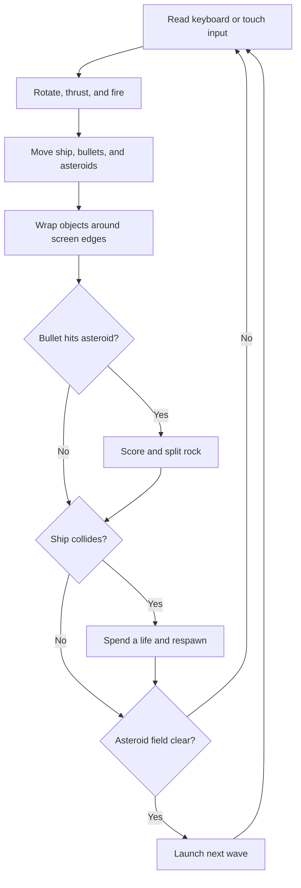

# Asteroid Field

A classic Asteroids-inspired arcade game built with Vue 3, TypeScript, and Canvas 2D. Pilot a wireframe ship through an endless field, split incoming rocks, and chase your personal best. No account or backend required.

**Play:** [oscarmmi.github.io/asteroids](https://oscarmmi.github.io/asteroids/)

## How to play

- **Rotate:** Left / Right arrows or **A / D**
- **Thrust:** Up arrow or **W**
- **Fire:** **Space**
- **Pause:** **Esc**
- **Restart:** **R**
- **Touch:** Use the on-screen rotate, thrust, and fire controls on phones.

Destroy large asteroids to split them into two medium rocks, then split those into small rocks. You have three lives, temporary protection after a collision, and a new wave whenever the field is clear. Your best score is stored locally in your browser.

## Run locally

```sh
npm install
npm run dev
```

Run the game-logic tests and production build:

```sh
npm test
npm run build
```

## Game loop



## Built with

- Vue 3 and TypeScript
- Canvas 2D rendering
- Vitest for deterministic game-logic tests
- Vite, deployed to GitHub Pages
